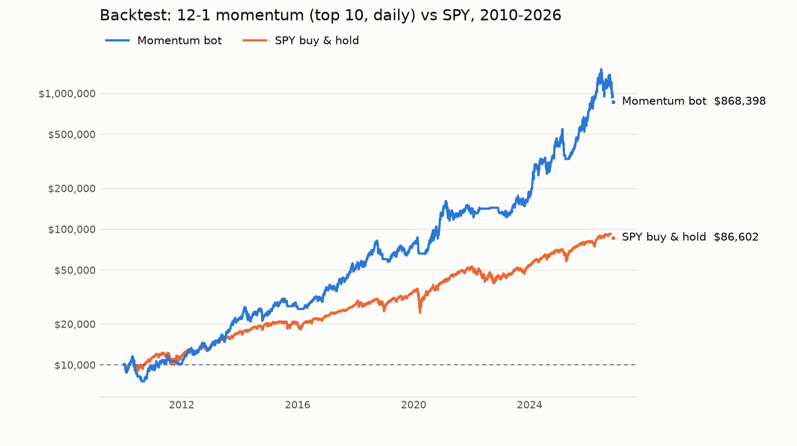

# Backtest results: 12-1 momentum vs SPY

> ## ⚠️ Survivorship bias warning
> This backtest uses **today's** S&P 500 list for the whole history. Companies that
> collapsed, went bankrupt or were removed from the index are missing, so the strategy
> could never pick a future loser by accident. Momentum strategies are especially
> flattered by this, because they buy stocks that have already risen a lot - and some of
> the real-life winners later crashed and left the index. **Real results would very likely
> have been worse than shown here.** Treat this as an optimistic upper bound, not a forecast.

_Generated 2026-11-19 · Period: 2010-01-05 to 2026-11-18 · Data: 503 of 503 current S&P 500 stocks had data (17.9 years of prices, first year used as warm-up)_

_The chart uses a log scale, so equal vertical distances mean equal % changes._

| | Momentum bot | SPY buy & hold | Today's S&P 500, equal weight* |
|---|---|---|---|
| $10,000 became | $868,398 | $86,602 | $167,128 |
| Total return | +8584% | +766% | +1571% |
| Yearly return (CAGR) | +30.2% | +13.6% | +18.2% |
| Max drawdown | -42.9% | -33.7% | -38.3% |
| Volatility (per year) | 30.3% | 17.1% | 17.9% |
| Sharpe ratio (no risk-free rate) | 1.03 | 0.84 | 1.03 |

\* **Survivorship-bias yardstick:** simply owning *all* of today's S&P 500 members in equal
amounts, with no strategy. Its lead over SPY (+4.5% per year) is roughly how much the survivor list alone flatters
results. The bot's lead over **this** column (+12.0% per year) is a fairer (still optimistic) guess at what momentum adds.

- **Return vs SPY:** +7818% total, +16.6% per year
- **Win rate:** 51% of 2891 closed trades sold above their purchase price
- **Right now** the bot is 43% below its all-time high in this backtest (0% = at a new high)
- **Time spent in cash** (crash filter): 16% of trading days
- **Trades:** 5792 total; assumed 0.1% slippage per trade, no commissions

## Daily vs weekly rebalancing

The bot is set to **daily** (change `REBALANCE_FREQUENCY` in `bot/config.py`). Same rules, same data, only how often it checks:

| Rebalance | $10,000 became | Yearly return | Max drawdown | Trades |
|---|---|---|---|---|
| daily | $868,398 | +30.2% | -42.9% | 5,792 |
| weekly | $849,904 | +30.1% | -46.3% | 2,656 |

_Daily checks react faster to the crash filter and to new leaders, but trade more, and each trade costs an assumed 0.1%._

## Year by year

| Year | Bot | SPY | Difference |
|---|---|---|---|
| 2010 | -7.3% | +13.2% | -20.5% |
| 2011 | +9.4% | +1.9% | +7.5% |
| 2012 | +33.4% | +16.0% | +17.4% |
| 2013 | +63.0% | +32.3% | +30.7% |
| 2014 | +10.4% | +13.5% | -3.1% |
| 2015 | +8.6% | +1.2% | +7.4% |
| 2016 | +35.6% | +12.0% | +23.6% |
| 2017 | +41.2% | +21.7% | +19.5% |
| 2018 | +19.0% | -4.6% | +23.6% |
| 2019 | +28.4% | +31.2% | -2.9% |
| 2020 | +63.5% | +18.3% | +45.2% |
| 2021 | +10.9% | +28.7% | -17.8% |
| 2022 | -6.2% | -18.2% | +12.0% |
| 2023 | +38.9% | +26.2% | +12.8% |
| 2024 | +122.5% | +24.9% | +97.7% |
| 2025 | +54.9% | +17.7% | +37.1% |
| 2026 | +37.9% | +7.9% | +30.0% |

## How the backtest works

- Universe: today's S&P 500 members (see warning above).
- Rebalance daily: rank stocks by the return from ~12 months ago to ~1 month ago, using prices up to the previous close.
- Hold the top 10, equal weight. Only stocks that drop out of the top 10 are sold; new entries are bought at the opening price.
- Crash filter: if SPY closed below its 200-day average, sell everything and wait in cash.
- Prices are adjusted for splits and dividends (dividends are effectively reinvested).
- Other things a backtest can't capture: taxes, real fill prices, data errors, and the fact that the strategy rules were picked knowing momentum worked in the past.

Files: [daily equity](backtest_equity.csv) · [all trades](backtest_trades.csv)
