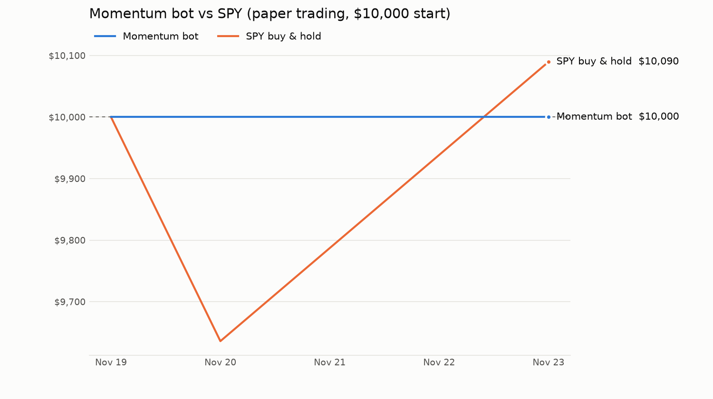

# Momentum Paper Trading Bot - Summary

> PAPER TRADING ONLY - no real money is involved.

_Last updated: 2026-11-23 22:19 UTC_

Tracking since **2026-11-19** (latest: 2026-11-23)

| Metric | Bot | SPY benchmark |
|---|---|---|
| Value | $10,000.00 | $10,089.68 |
| Total return | +0.00% | +0.90% |
| Max drawdown | 0.00% | -3.64% |

**Return vs SPY:** -0.90% (behind the benchmark)

**Win rate:** n/a (no positions sold yet)

## Current holdings

None - the bot is 100% in cash.

Cash: $10,000.00

## Recent trades

No trades yet.

Files: [trades.csv](trades.csv) · [performance.csv](performance.csv) · [log](logs/bot.log) · [backtest](backtest/backtest_results.md)
